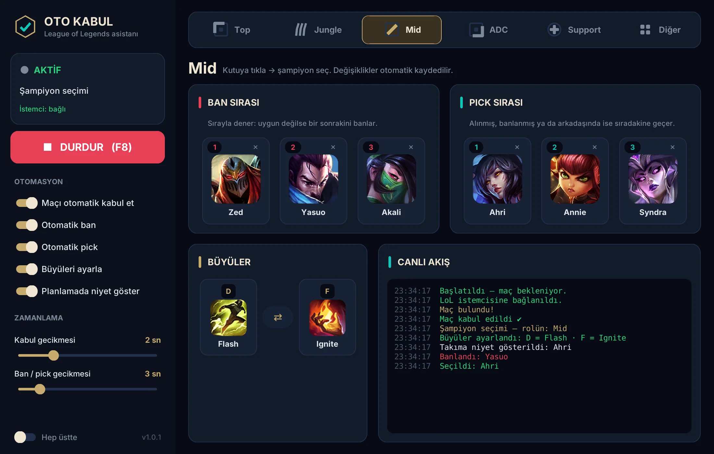

<h1 align="center">LoL Oto Kabul</h1>

League of Legends için otomatik maç kabul, role göre ban/pick sırası ve büyü ayarlayan ücretsiz Windows asistanı.

  <a href="https://github.com/larrylaffer0623/lol-oto-kabul-releases/releases/latest/download/LoLOtoKabul-Kurulum.exe"><b>⬇ Kurulum dosyasını indir</b></a> ·
  <a href="https://lolotokabul.vercel.app">Web sitesi</a>

## Özellikler

- **Otomatik kabul:** Maç bulununca kendiliğinden kabul eder.
- **Ban sırası:** Her rol için 3 ban seçersin. Seçtiğin şampiyon banlanmış ya da alınmışsa sıradakini banlar.
- **Pick sırası:** Top, Jungle, Mid, ADC ve Support için 3'er şampiyon seçersin.
- **Büyüler:** Her rol için D ve F büyülerini ayrı ayrı ayarlar.
- **Kendini günceller:** Yeni sürüm çıkınca açılışta sessizce kurulur.

## Kurulum

1. [LoLOtoKabul-Kurulum.exe](https://github.com/larrylaffer0623/lol-oto-kabul-releases/releases/latest/download/LoLOtoKabul-Kurulum.exe) dosyasını indir.
2. Dosyaya çift tıkla. Yönetici izni istemez.
3. Windows "bilgisayarınızı korudu" uyarısı verirse **Ek bilgi → Yine de çalıştır** de.

Program oyuna ya da oyunun belleğine dokunmaz. Sadece League istemcisinin kendi yerel API'sini kullanır.

> Bu repo sadece kurulum dosyalarını barındırır. Riot Games ile bağlantılı değildir.
